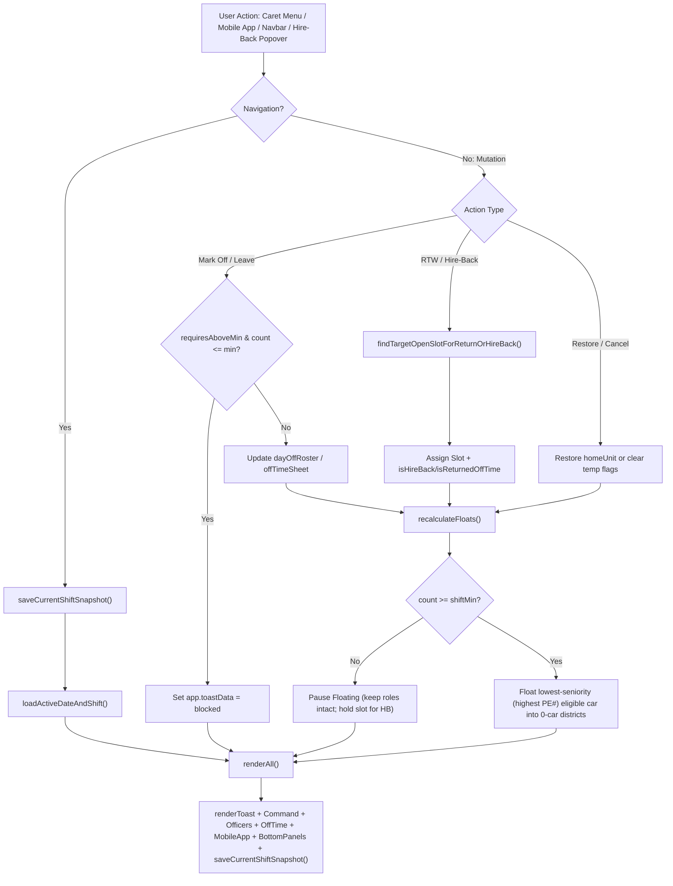

# ARCHITECTURE.md — FWPD "The Books"

**Repository:** `/home/antigravity/macc0311/fwpd-the-books`  
**Active Branch:** `macc-dev` (synced with `origin/macc-dev` and `main` at `e91d318`)  
**Primary Runtime Artifact:** `index.html` (12,893 lines / 355,391 bytes — self-contained HTML + CSS + JavaScript monolith)  
**Target Environment:** Static browser SPA / GitHub Pages (`macc0311/fwpd-the-books`), zero build step, zero backend database

---

## 1. Repository Inventory & Branch Topology

### 1.1 Files on Disk

| File | Size (Bytes) | Lines | Role |
| :--- | ---: | ---: | :--- |
| `index.html` | 355,391 | 12,893 | Complete single-file application: CSS design system, DOM layout (Top Navbar, Toast, 4-Division Worksheet, Mobile App Companion, Bottom Analytics/Audit Grid, Popover, Publish Modal), embedded multi-shift/bureau schedule templates, 290-officer directory, scheduling/float/leave/hire-back engines, and standalone HTML release exporter. |
| `PBA_Contract_2026.md` | 122,973 | 840 | Markdown transcription of the 2026 Fort Wayne Patrolmen's Benevolent Association (PBA) CBA (commissioned officers below rank of Sergeant). |
| `PBA_Contract_2026.docx` | 67,188 | — | Original Word document source for `PBA_Contract_2026.md`. |
| `FOPLC_Contract_2026.md` | 80,659 | 466 | Markdown transcription of the 2026 Fort Wayne Fraternal Order of Police Labor Council (FOPLC) CBA (Sergeants and Lieutenants). |
| `2026 FOPLC Final Contract.pdf` | 342,022 | — | Original PDF source for `FOPLC_Contract_2026.md`. |

### 1.2 Git Branch & Recent History

- **`macc-dev`** (`* macc-dev`, tracking `origin/macc-dev`): Active development branch. All feature engineering happens here.
- **`main`** (`origin/main`, `origin/HEAD -> origin/main`): Production/GitHub Pages branch. Currently at parity with `macc-dev` via merge commit `e91d318` (`Merge branch 'main' into macc-dev`).
- **Key Recent Commits:**
  - `6123c40` — Pause floating when shift drops below minimum so awarded Hire-Back fills vacated role directly.
  - `b230954` — Automate Hire-Back opt-in notifications, bidding engine (`>=24hr` seniority vs `<24hr` FCFS), and winner schedule placement.
  - `4dcbd71` — Order Hire-Back search filter tabs as `A`, `B`, `C`, and `All`.
  - `66f685c` — Replace Hire-Back Quick Award section with searchable officer database.
  - `dd0db4e` — Enable toggling any officer, return-to-work from scheduled off-time, and minimalist cross-shift hire-backs.
  - `9de0fb7` — Unify marked-off officers into bottom Scheduled Off-Time category columns.

---

## 2. High-Level System Architecture & External Coupling

```
+-----------------------------------------------------------------------------------+
|                               index.html (12,893 lines)                           |
|                                                                                   |
|  1. <head> (L3-213)         : Tailwind CDNs + CSS Custom Properties & Grid CSS    |
|  2. <body> HTML (L214-647)  : Header Navbar, Toast, Split Workspace, Popover      |
|  3. Data Layer (L650-10244) : DIV_DISTRICTS, ALL_SCHEDULES + DB_SCHEDULES,        |
|                               MASTER_OPERATIONS_DIRECTORY, DEFAULT_OPT_IN_PES     |
|  4. State & Helpers (L10246): app state + savedHistory (in-memory only!)          |
|  5. Engines (L10649-11830)  : Float Engine, Popovers, Hire-Back Engine, Leave/RTW |
|  6. Renderers (L11835-12762): Worksheet, Off-Time, Mobile App, Bottom Cards       |
|  7. Exporter (L12764-12888) : Standalone HTML builder & GitHub publish modal      |
+-----------------------------------------------------------------------------------+
```

### 2.1 External Dependencies & Persistence Constraints

1. **Tailwind CSS Runtime Coupling (`index.html` L7–8):**
   - Loads **both** `https://www.gstatic.com/antigravity/web/dev/tailwindcss.min.js` (L7) and `https://cdn.tailwindcss.com` (L8) in `<head>`.
   - Zero build pipeline; Tailwind utility classes are compiled client-side in the browser at runtime. Offline use without CDN access loses utility styling unless a local stylesheet is introduced.
2. **In-Memory Only Persistence:**
   - All shift edits, leave approvals, floats, hire-back bids, opt-in toggles, and audit logs live strictly in the JavaScript `app` object and `app.savedHistory` (`L10246-10268`).
   - There is **no** backend API, **no** database, and **no** `localStorage` / `sessionStorage` persistence. Reloading the browser tab resets all state back to initial template values via `initApp()` (`L12890`).
3. **Preview Artifact & GitHub Pages Release Coupling (`L12758-12888`):**
   - `#publishHelperBtn` (`L321`) automatically hides when `window.location.hostname.includes('github.io')` (`L12759-12762`).
   - Inside preview environments (e.g., Antigravity web preview iframe), `buildStandaloneReleaseHtml()` (`L12764-12779`) clones `document.documentElement`, strips injected preview `<style>` tags that lack `--bg-app` (`L12767-12769`), removes `#publishHelperBtn` and `#publishHelperModal`, resets `#transactionToast` and `#floatingActionMenu`, and outputs clean standalone HTML for direct commit to `macc-dev` or `main`.

---

## 3. CSS Design System & State Styling (`index.html` L9–212)

### 3.1 Theme Custom Properties (`:root` L10–29 & `body.dark-mode` L31–50)

| CSS Token | Light (`:root`) | Dark (`body.dark-mode`) | Purpose |
| :--- | :--- | :--- | :--- |
| `--bg-app` | `#f1f5f9` | `#090d16` | Page canvas background (also sentinel checked in `buildStandaloneReleaseHtml()` L12768) |
| `--bg-surface` | `#ffffff` | `#111827` | Cards, popovers, shift metrics boxes |
| `--bg-subtle` | `#f8fafc` | `#1e293b` | Unit cells, sheet header/footer bars, floated-out slots |
| `--bg-header` | `#0f172a` | `#0f172a` | Top navbar background token |
| `--bg-div-head` | `#1e293b` | `#1e293b` | 4-Division table title bar background |
| `--bg-col-head` | `#f1f5f9` | `#1f2937` | `UNIT / COMMAND / OFFICERS / ASSIGN` sub-header background |
| `--border-grid` | `#e2e8f0` | `#1f2937` | Inner table cell hairline borders |
| `--border-strong` | `#cbd5e1` | `#374151` | Card borders and `.div-sep-right` division separators |
| `--text-main` | `#0f172a` | `#f8fafc` | Primary body and officer name text |
| `--text-muted` | `#64748b` | `#94a3b8` | PE numbers, unit codes, subheaders, metadata |
| `--text-faint` | `#94a3b8` | `#475569` | Footer date watermark |
| `--accent-blue` | `#2563eb` | `#3b82f6` | Logged-in officer accent & hover caret highlight |
| `--accent-blue-soft` | `#eff6ff` | `rgba(59, 130, 246, 0.14)` | Logged-in row background tint |
| `--float-bg` | `#fffbeb` | `rgba(245, 158, 11, 0.14)` | Floated-in / Hire-Back / RTW destination highlight |
| `--float-border` | `#f59e0b` | `#f59e0b` | Left 3px indicator bar on floated/temporary rows |
| `--float-text` | `#92400e` | `#fde68a` | Float contrast text token |
| `--dayoff-bg` | `#fef2f2` | `rgba(239, 68, 68, 0.12)` | Dynamic marked-off cell tint in bottom Off-Time table |
| `--dayoff-text` | `#991b1b` | `#fca5a5` | Dynamic marked-off officer name text color |

### 3.2 Worksheet, Interactive & Companion Component Classes

| Selector | Lines | Visual Behavior & Purpose |
| :--- | :--- | :--- |
| `.books-sheet-card` | `L60-66` | Rounded 14px bordered card container with elevation shadow. |
| `.books-table` | `L68-85` | `table-layout: fixed`, `border-collapse: collapse`, compact `25px` row height, `11.5px` text with ellipsis truncation. |
| `.div-sep-right` | `L88-90` | `2px solid var(--border-strong) !important` vertical divider between `NW | NE | SW | SE` columns (and 4 off-time columns). |
| `.div-title-cell` | `L92-100` | Uppercase dark division title bar (`--bg-div-head`). |
| `.col-sub-cell` | `L102-111` | `10px` bold centered column header (`UNIT`, `OFFICERS`, `ASSIGN`). |
| `.unit-cell` | `L113-119` | Monospace centered unit slot identifier (`C117`, `M419`, `543`). |
| `.unit-bid-car` | `L122-129` | Standing Union Bid Car indicator: bold underlined text, emerald `rgba(16,185,129,0.08)` tint, `inset 2.5px 0 0 #10b981` left bar. |
| `.row-logged-in` | `L132-135` | Blue highlight (`--accent-blue-soft` + 3px left `--accent-blue` bar) for the currently selected `app.loggedInPe` across active roster and bottom off-time rows. |
| `.row-floated-in` & `@keyframes rowPulse` | `L138-153` | Amber highlight (`--float-bg` + 3px left `--float-border` bar + `0.9s` pulse) applied to floated-in, Hire-Back (`isHireBack`), and Returned-to-Work (`isReturnedOffTime`) cells. |
| `.row-floated-out` | `L145-148` | Subtle muted styling (`--bg-subtle`) for vacated or floated-away slots. |
| `.caret-btn` | `L156-183` | `18x18px` `▾` action menu trigger shown on every occupied officer row and bottom off-time entry. |
| `#floatingActionMenu` & `@keyframes menuPop` | `L186-200` | `position: fixed; z-index: 100`, animated popover anchored near clicked trigger (`L10754-10769`). |
| `.phone-frame` | `L203-211` | Fixed `340px`-wide iPhone-style bezel framing `#mobileAppPane`. |

---

## 4. Top-Level HTML Layout Regions & DOM Element Map (`index.html` L214–647)

| Region | Lines | Key DOM IDs & Controls |
| :--- | :--- | :--- |
| **1. Top Navbar (`<header>`)** | `L221-327` | `#shiftHistoryStateBadge` (Live Schedule vs Historical Reflection); `#viewBtn-split`, `#viewBtn-sheet` (`setViewMode`); `#bureauSeg-OPS`, `#bureauSeg-DB` (`selectBureau`); `#scheduleDateInput` + `‹`/`›` (`stepDate`, `handleDateInputChange`); `#shiftSeg-A`, `#shiftSeg-B`, `#shiftSeg-C` (`selectShiftCode`); `#loggedInUserSelect` (`handleUserSwitch`); `#floatScopeSelect` (`citywide` \| `quadrant`, triggers `recalculateFloats()`); `#themeToggleBtn` (`toggleTheme`); Reset (`resetSchedule()`); `#publishHelperBtn` (`openPublishModalAndCopy()`). |
| **2. Transaction & Contract Stepper Toast** | `L332` | `#transactionToast` — hidden by default; renders red blocked-action alert (with `forceApprovePendingDayOff()` override) or green multi-step contract audit toast + live Automated Hire-Back broadcast bar (`renderToast()`). |
| **3. Split Workspace Grid** | `L337-638` | Responsive `flex-col 2xl:flex-row` container pairing Left Worksheet + Right Mobile Companion. |
| **3A. Left: "The Books" Worksheet Card** | `L344-552` | **Header Bar (`L347-396`):** `#sheetMinBanner`, `#sheetMinDot`, `#sheetMinText` (click opens Hire-Back popover), `changeMinimum(-1/1)`, `#demoMinControlVal`, `setMinForVacationDemo()`, `openHireBackPopover(event)`, `#paperScheduleHeadline`, `#paperGuardDutyBanner`, `#paperShiftMin`, `#paperShiftCount`, `#paperSpecialAlertBanner`.<br>**4-Division Spreadsheet (`L401-527`):** `<colgroup>` (`4.3% / 15.2% / 5.5%` × 4 = 12 cols). Division titles `#divTitle-NW/NE/SW/SE` and car counts `#divCount-NW/NE/SW/SE`. Dynamic `<tbody id="paperCommandBody">`, `<tbody id="paperOfficersBody">`.<br>**Bottom Unified Off-Time Grid (`L490-526`):** `#scheduledOffTimeTitle`, 4 category counters `#offColCount-dayOff`, `#offColCount-vacation`, `#offColCount-sickAndLeave`, `#offColCount-trainingAndSpecial`, and `<tbody id="paperScheduledOffTimeBody">`.<br>**Footer Legend (`L532-550`):** Bid Car, Logged-In, Float indicators, and `88 = Off-Duty Time • 87 = On-Duty Time`. |
| **3B. Right: Companion Mobile App (`#mobileAppPane`)** | `L598-636` | `.phone-frame` (`340px` wide) displaying `#mobileAppShiftBadge` and dynamic `#mobileAppBody` (`renderMobileAppCompanion()`). Synchronized bidirectionally with `app.loggedInPe` and worksheet state. |
| **4. Bottom 3-Column Analytics & Audit Cards** | `L555-591` | **Card 1 (`L557-567`):** `#floatQueueMiniList` — Next-to-Float PE# Queue (or pause banner when `count < min`).<br>**Card 2 (`L570-579`):** `#hireBackCountBadge`, `#districtCoverageMiniGrid` (14 districts `A–O`), `#hireBackActionBox` (Hire-Back Bid Engine summary & Award button).<br>**Card 3 (`L582-590`):** `#auditMiniList` — Reverse-chronological real-time contract & action log. |
| **5. Floating Popover Menu** | `L645-647` | `#floatingActionMenu` wrapping `#floatingMenuContent`; shared container used both by `openOfficerActionPopover()` (`ON_DUTY`, `STATIC_OFF`, `DAY_OFF` modes) and `openHireBackPopover()` (Hire-Back bidding + searchable officer database). |
| **6. Dynamic Publish/Export Modal** | `L12844-12886` | `#publishHelperModal` created dynamically in DOM by `openPublishModalAndCopy()`, containing `#copyStatusBadge`, `#exportRawCodeBox`, and direct GitHub edit/compare links to `macc-dev` and `main`. |

---

## 5. JavaScript Data Layer & Record Schemas (`index.html` L650–10244)

> **Important Architectural Note:** There are **no** constants named `BUREAU_SCHEDULE_KEYS`, `SCHEDULE_KEY_MAP`, `OFF_TIME_STATIC_SHEETS`, `HISTORICAL_SHIFTS`, or `HIREBACK_POOL` (the latter was removed in commit `66f685c`, leaving only one dead reference inside `fillHireBackNow()`). Bureau/date/shift mapping is implemented procedurally in `resolveScheduleTemplate()`, static off-time data is embedded as `offTimeSheet` inside each schedule object, and historical/edited states are cached per-session in `app.savedHistory`.

### 5.1 Core Constants

- `DIV_KEYS` (`L653`): `['NW', 'NE', 'SW', 'SE']`
- `DIV_DISTRICTS` (`L654-659`):
  - `NW`: `['A', 'B', 'C']`
  - `NE`: `['E', 'F', 'G']`
  - `SW`: `['I', 'J', 'K', 'L']`
  - `SE`: `['D', 'M', 'N', 'O']` *(includes Downtown `D` cars `D11–D92`)*
- `DEFAULT_HIREBACK_OPT_IN_PES` (`L10244`): `[1689, 1742, 1746, 1860, 1997, 2013, 1586, 1732, 1844, 1924, 2021]` (11 pre-opted-in PEs).

### 5.2 Schedule Templates (`ALL_SCHEDULES` L661–5397 + `DB_SCHEDULES` L5398–7625)

`DB_SCHEDULES` is merged into `ALL_SCHEDULES` at `L7626` via `Object.assign(ALL_SCHEDULES, DB_SCHEDULES)`.

| Key | Lines | Bureau | Shift / Hours | Initial Min | Initial Occupied | Bid Cars | Notes |
| :--- | :--- | :--- | :--- | ---: | ---: | ---: | :--- |
| `A_11_15` | `L662-1817` | `OPS` | `A` (`0600–1430 hrs`) | 32 | 32 (`8/8/9/7`) | 14 | Default boot schedule (`2026-11-15`); default PE `1883` (`MAURER, A`). |
| `A_11_17` | `L1818-3010` | `OPS` | `A` (`0600–1430 hrs`) | 32 | 36 (`8/8/9/11`) | 14 | Includes `specialAlert: "ONE LT. AND ONE OFF. HIRE BACK NEEDED"`. |
| `B_11_16` | `L3011-4204` | `OPS` | `B` (`1400–2230 hrs`) | 40 | 42 (`10/8/11/13`) | 13 | Default PE `2091`. |
| `C_11_15` | `L4205-5397` | `OPS` | `C` (`2200–0630 hrs`) | 34 | 36 (`9/7/10/10`) | 14 | Includes 3 occupied `K9` rows (`K9-3`, `K9-12`, `K9-8`) and `guardDutyNote`. |
| `DB_FLEX` | `L5399-6495` | `DB` | `A` (`0800–1630 hrs (Flex)`) | 30 | 48 (`6/12/12/18`) | 0 | Custom `colHeaders` (Property/Vice, Crimes Against Person, Auto/Fin/DV/Crime Scene, Juv/Homicide/Robbery), 12 cmd rows/col, 27 officer rows/col with 16 `sectionHeader` dividers. |
| `DB_C` | `L6496-7625` | `DB` | `C` (`1100–0730 / 1800–0200 hrs`) | 2 | 5 (`3/2/0/0`) | 0 | Custom `colHeaders`, 2 rendered cmd rows (of 12 stored), 27 officer rows/col with 4 `sectionHeader` dividers. |

#### Schedule Object Schema
```js
{
  id: string,                  // e.g. "A_11_15", "DB_FLEX"
  bureau?: "DB",               // present on DB_SCHEDULES templates
  shiftCode: "A" | "B" | "C",
  shiftTitle: string,
  shiftHours: string,
  dateStr: string,
  shortTab?: string,           // OPS only
  footerDate: string,
  shiftMin: number,
  defaultOfficerPe: number,
  codLabel: string,
  specialAlert: string,
  guardDutyNote: string,
  colHeaders?: string[4],      // DB only; overrides default 4-division headers
  command: { NW: CommandRow[], NE: CommandRow[], SW: CommandRow[], SE: CommandRow[] },
  officers: { NW: OfficerRow[], NE: OfficerRow[], SW: OfficerRow[], SE: OfficerRow[] },
  offTimeSheet: {
    dayOff: string[],
    vacation: string[],
    sickAndLeave: string[],
    trainingAndSpecial: string[]
  }
}
```

#### Command, Officer & Static Off-Time Schemas
- **Command Row (`command[div][i]`):** `{ unit: string, name: string, pe: number|null, assign: string, bold?: boolean, highlight?: boolean }`
- **Officer Row (`officers[div][i]`):** `{ unit: string, bidCar: boolean, name: string, pe: number|null, assign: string, partner?: string, highlight?: boolean, sectionHeader?: string }`
  - When `sectionHeader` is present (Detective Bureau), `renderPaperOfficerRows()` (`L12083-12086`) renders a `colspan="3"` section divider instead of a car row.
- **Static Off-Time String (`offTimeSheet[colKey][i]`):** Parsed by `parseStaticOffTimeString()` (`L10281-10302`) using regex `/^(.+?)\s*\((\d+)\)\s*(.*?)(?:\[(.+?)\])?\s*$/` into `{ name, pe, hrs, tag, rawStr, colKey, idx }`. Example: `"HAWTHORNE, C (1909) 8.5 hrs [PREF. VACATION]"`.

### 5.3 Master Operations Directory (`MASTER_OPERATIONS_DIRECTORY`, `L7628-10239`)

Array of **290 unique officer/command records** across shifts (`A`: 97, `B`: 103, `C`: 90) and roles (`OFFICER`: 127, `OFF_TIME`: 120, `PARTNER/PROB`: 15, `COMMAND`: 28):
```js
{
  name: string,     // e.g. "AGUILAR, M"
  pe: number,       // e.g. 1873 (unique across all 290 entries)
  role: "OFFICER" | "OFF_TIME" | "PARTNER/PROB" | "COMMAND",
  shift: "A" | "B" | "C",
  schedId: string,  // e.g. "A_11_17", "B_11_16", "C_11_15"
  unit: string,     // e.g. "F223" or "OFF"
  div: string       // "NW" | "NE" | "SW" | "SE" | ""
}
```

### 5.4 Leave Configuration Map (`LEAVE_CONFIG_MAP`, `L11349-11398`)

| Action Key | `shortCode` | `categoryCol` | `requiresAboveMin` | `article` |
| :--- | :--- | :--- | :---: | :--- |
| `DAY_OFF_VAC` | `VAC / DAY OFF` | `vacation` | `true` | `Art. 43 §4` |
| `DAY_OFF_PERS` | `PERSONAL` | `vacation` | `true` | `Art. 44 §1` |
| `DAY_OFF_FLSA` | `FLSA COMP` | `vacation` | `true` | `Art. 39 §2` |
| `SICK` | `SICK LEAVE` | `sickAndLeave` | `false` | `Art. 50 & Art. 35 §3` |
| `BEREAVEMENT` | `BEREAVEMENT` | `sickAndLeave` | `false` | `Art. 45` |
| `UTB` | `UNION TIME` | `trainingAndSpecial` | `false` | `Art. 16 §1` |

---

## 6. Application State & Snapshot Lifecycle (`index.html` L10246–10484)

### 6.1 Global State Objects

- **`app` (`L10246-10268`):**
  - `selectedBureau`: `'OPS'` \| `'DB'` (default `'OPS'`)
  - `selectedDate`: ISO `'YYYY-MM-DD'` string (default `'2026-11-15'`)
  - `selectedShift`: `'A'` \| `'B'` \| `'C'` (default `'A'`)
  - `activeScheduleId`: `'A_11_15'` (resolved template ID)
  - `shiftMin`: `32` (editable via `changeMinimum()`, `setMinForVacationDemo()`, or `forceApprovePendingDayOff()`)
  - `loggedInPe`: `1883` (numeric PE# or `'COD'`)
  - `viewMode`: `'split'` \| `'sheet'`
  - `darkMode`: `boolean`
  - `command`, `officers`, `offTimeSheet`: active mutable clones for the current shift view
  - `dayOffRoster`: `{ NW: [], NE: [], SW: [], SE: [] }` — dynamic marked-off officers (`{ homeUnit, div, name, pe, status, categoryCol, fullLabel, time }`)
  - `floatedMoves`: `Array<{ name, pe, fromUnit, fromDiv, toUnit, toDiv, district }>`
  - `auditEntries`: `Array<{ time, msg, tag }>` (newest prepended via `unshift`)
  - `toastData`: `null` \| `{ status: 'approved'|'blocked', title, step1, step2?, step3?, pendingAction? }`
  - `hireBackNoticeMode`: `'SENIORITY_24HR'` \| `'FCFS_UNDER_24HR'`
  - `hireBackOptInPes`: `number[]` (initialized from `DEFAULT_HIREBACK_OPT_IN_PES`)
  - `hireBackBids`: `Array<{ pe, name, shift, unit, timestamp, bidOrder }>`
  - `hireBackBidCounter`: monotonic integer tracking submission order
  - `hireBackLastWinnerNotification`: `null` \| `{ pe, name, shift, assignedUnit, assignedDiv, ruleLabel, timestamp }`
  - `savedHistory`: `Record<string, Snapshot>` keyed by `` `${selectedBureau}_${selectedDate}_${selectedShift}` ``
- **`hireBackDbState` (`L10952-10956`):** `{ shiftFilter: 'ALL', preferredDiv: null, preferredUnit: null }`
- **Runtime Enrichments on `app.officers[div][i]` (`loadActiveDateAndShift` L10436-10446 & mutations):**
  - `district` (`parseDistrict(row.unit)`), `homeName`, `homePe`, `homePartner`, `isHireBack`, `isReturnedOffTime`, `returnedMeta`, `hireBackShift`, `floatedFrom` (`{ unit, div }` \| `null`), `floatedTo` (`{ unit, div, name, pe }` \| `null`).

### 6.2 Snapshot Persistence (`saveCurrentShiftSnapshot` & `loadActiveDateAndShift`)

- Before any bureau, date, or shift change (`stepDate`, `handleDateInputChange`, `selectBureau`, `selectShiftCode`, `switchSchedule`), `saveCurrentShiftSnapshot()` (`L10345-10360`) deep-clones the current state (`shiftMin`, `command`, `officers`, `offTimeSheet`, `dayOffRoster`, `floatedMoves`, `hireBackBids`, `hireBackBidCounter`, `hireBackLastWinnerNotification`, `auditEntries`) into `app.savedHistory[key]`.
- `renderAll()` (`L11947`) also writes a snapshot on every render pass.
- `loadActiveDateAndShift(targetOfficerPe)` (`L10411-10478`) restores from `app.savedHistory[key]` if present, or instantiates a fresh clone from `resolveScheduleTemplate(selectedDate, selectedShift)`. Dates `< '2026-11-15'` are tagged `Historical Reflection` (`ARCHIVE`).

---

## 7. JavaScript Engines & Control Flow

### 7.1 Control Flow Overview



### 7.2 Subsystem Function Inventory (Exact Line Ranges)

1. **Bureau / Date / Shift Navigation & Utilities (`L10270-10597`):**
   - `clone(o)` (`L10270-10272`) — JSON deep clone helper.
   - `parseDistrict(unitStr)` (`L10274-10279`) — extracts leading `[A-O]` district letter, explicitly excluding `K9*` (`return ''`).
   - `parseStaticOffTimeString(rawStr, colKey, idx)` (`L10281-10302`) — regex parser for off-time text rows.
   - `formatLongDate(isoDate)` (`L10304-10313`), `formatShortDate(isoDate)` (`L10315-10323`).
   - `resolveScheduleTemplate(isoDate, shiftCode)` (`L10325-10343`) — if `selectedBureau === 'DB'`, returns `DB_C` (`shiftCode === 'C'`) or `DB_FLEX`; if `OPS`, matches `2026-11-15`/`16`/`17` explicitly, otherwise falls back to odd/even day parity (`A_11_17` vs `A_11_15`), `B_11_16`, or `C_11_15`.
   - `saveCurrentShiftSnapshot()` (`L10345-10360`), `stepDate(deltaDays)` (`L10362-10373`), `handleDateInputChange(newDateVal)` (`L10375-10380`), `selectBureau(bureauCode)` (`L10382-10386`), `selectShiftCode(shiftCode, targetOfficerPe)` (`L10388-10392`), `switchSchedule(schedId, targetOfficerPe)` (`L10394-10409`), `loadActiveDateAndShift(targetOfficerPe)` (`L10411-10478`), `initApp()` (`L10480-10484`).
   - `populateUserSelect()` (`L10486-10553`), `handleUserSwitch(overridePe)` (`L10555-10575`), `setViewMode(mode)` (`L10577-10591`), `toggleTheme()` (`L10593-10597`).

2. **Staffing Count, District Coverage & Lookup (`L10599-10647`):**
   - `findOfficerByPe(peNum)` (`L10599-10624`) — resolves an officer across 4 states in priority order: `'ON_DUTY'` (`app.officers`), `'DAY_OFF'` (`app.dayOffRoster`), `'STATIC_OFF'` (`app.offTimeSheet`), or `'OTHER_SHIFT'` (`MASTER_OPERATIONS_DIRECTORY`).
   - `getShiftCount()` (`L10626-10634`) — counts all rows across `DIV_KEYS` where `r.name && r.pe !== null`.
   - `getDistrictCounts()` (`L10636-10647`) — initializes all 14 districts in `DIV_DISTRICTS` to `0`, then increments for occupied rows with non-empty `r.district`.

3. **Core Float Engine (`recalculateFloats`, `L10655-10749`):**
   - Phase 1 (`L10656-10675`): Deterministic reset — clears `floatedFrom`, `floatedTo`, and `app.floatedMoves`; skips `isHireBack` and `isReturnedOffTime` rows; empties rows whose `unit` is in `app.dayOffRoster[div]`, otherwise restores `homeName`/`homePe`/`homePartner`.
   - Phase 2 Guard (`L10679`): **Below-minimum pause guard** — `if (currentCount >= app.shiftMin)` is required before any floating occurs. When below minimum, all on-duty officers stay in their normal assignments so an awarded Hire-Back officer fills the vacated slot directly.
   - Phase 3 Iterative District Fill (`L10680-10745`): Iterates `DIV_KEYS` × `DIV_DISTRICTS[div]`. Whenever `distCounts[dist] === 0`:
     - Picks target slot in priority: vacated day-off car in `dist` → open non-bid car in `dist` → any open car in `dist`.
     - Collects eligible donors across `DIV_KEYS` rejecting empty rows, `r.bidCar === true`, and `distCounts[r.district] <= 1` (sole-district-car guard).
     - Sorts candidates: if `floatScopeSelect === 'quadrant'`, prefers `a.div === div` first; then sorts by `b.row.pe - a.row.pe` (highest PE# / lowest seniority first).
     - Moves top candidate to `targetRow`, records `floatedFrom`, `floatedTo`, `app.floatedMoves`, and refreshes `distCounts`.
   - Ends with `populateUserSelect()` and `renderAll()`.

4. **Leave, Return-to-Work & Off-Time Management (`L10754-10947`, `L11336-11824`):**
   - Popover UI: `positionPopoverNearEvent()` (`L10754-10769`), `openOfficerActionPopover(event, mode, divOrCol, unitOrIdx)` (`L10771-10947`, handles `'ON_DUTY'`, `'STATIC_OFF'`, `'DAY_OFF'`), `closeActionPopover()` (`L11336-11339`), `triggerLeaveAction()` (`L11341-11344`).
   - Officer Status & Leave: `handleOfficerStatusSelect()` (`L11607-11662`, handles `CODE_88`, `CODE_87`, min-count hold toast, or execution), `forceApprovePendingDayOff()` (`L11664-11671`), `executeApprovedLeaveMove()` (`L11673-11750`, moves temp or permanent officer off-duty, recalculates floats, triggers `ensureAutomatedHireBackBroadcast()` if `countAfter < shiftMin`, writes toast + audit).
   - Restore & Static Off-Time: `restoreOfficerFromDayOff()` (`L11752-11783`, clears temporary HB/RTW flags if someone filled the home car), `handleDayOffActionSelect()` (`L11785-11801`), `returnStaticOfficerToWork()` (`L11449-11489`), `moveStaticOffTimeOfficer()` (`L11491-11502`), `cancelTemporaryDutyRow()` (`L11504-11536`).
   - Demo / Min Controls: `changeMinimum(delta)` (`L11803-11806`), `setMinForVacationDemo()` (`L11808-11818`), `resetSchedule()` (`L11820-11824`).

5. **Automated Hire-Back Notification, Opt-In, Search & Bidding Engine (`L10952-11605`):**
   - Opt-In & Mode: `isOfficerOptedInForHireBack(pe)` (`L10958-10960`), `toggleOfficerHireBackOptIn(pe, officerName)` (`L10962-10984`), `setHireBackNoticeMode(mode)` (`L10986-10992`).
   - Broadcast & Ranking: `ensureAutomatedHireBackBroadcast()` (`L10994-11025`, filters out on-duty PEs; seeds `#1997`, `#2013`, `#1689` if empty when `count < min`), `getSortedHireBackBids()` (`L11027-11041`: `bidOrder` ascending for `FCFS_UNDER_24HR`, `pe` ascending for `SENIORITY_24HR`), `submitOfficerHireBackBid()` (`L11043-11084`), `autoAwardWinningHireBackBid()` (`L11086-11103`).
   - Searchable Database Popover: `openHireBackPopover()` (`L11105-11150`), `renderHireBackPopoverSections()` (`L11152-11225`), `setHireBackShiftFilter()` (`L11227-11230`), `renderHireBackDatabaseResults()` (`L11232-11334` — deduplicates `MASTER_OPERATIONS_DIRECTORY`, excludes `COMMAND` and active on-duty PEs, sorts by `pe` ascending, filters by `A | B | C | ALL` + text query).
   - Slot Resolution & Award: `findTargetOpenSlotForReturnOrHireBack()` (`L11400-11446`), `awardCrossShiftHireBack()` (`L11538-11605` — places winner directly, runs `recalculateFloats()`, clears bid pool if `countAfter >= shiftMin`, sets `app.hireBackLastWinnerNotification`, switches `app.loggedInPe = pe`, writes toast + audit).

6. **Rendering Pipeline (`L11835-12762`):**
   - `renderAll()` (`L11835-11955`): updates metrics, status pill, bureau/shift active classes, date/history badge, dynamic column headers (`colHeaders`), headlines, saves snapshot, and invokes:
     - `renderToast()` (`L11957-12034`)
     - `renderPaperCommandRows()` (`L12039-12069`)
     - `renderPaperOfficerRows()` (`L12074-12169`)
     - `renderPaperScheduledOffTimeRows()` (`L12236-12297`) via `inferOffTimeCategory()` (`L12174-12181`), `formatStaticOffTimeEntry()` (`L12183-12216`), `formatDynamicMarkedOffEntry()` (`L12218-12234`)
     - `renderMobileAppCompanion(count, min)` (`L12302-12638`)
     - `renderBottomPanels(count, min)` (`L12643-12762`)

7. **Standalone Export / Publish Helper (`L12764-12888`):**
   - `buildStandaloneReleaseHtml()` (`L12764-12779`), `copyReleaseHtmlToClipboard()` (`L12781-12812`), `fallbackCopy()` (`L12814-12826`), `downloadReleaseHtmlFile()` (`L12828-12839`), `openPublishModalAndCopy()` (`L12841-12888`).

---

## 8. Technical Debt, Known Defects & Fragility Warnings

Downstream engineering agents modifying `index.html` must be aware of the following verified issues (do not silently break surrounding behavior):

1. **Broken Quick-Switcher Calls in Mobile Preview (`L12331`, `L12334`, `L12337`):**
   - Inside `renderMobileAppCompanion()`, the 3 quick-switcher pills (`Maurer #1883`, `Engelman #1586`, `Aguilera #1997`) call `onclick="switchUserRole('...')"`.
   - `switchUserRole` is **undefined** anywhere in `index.html`; clicking any of those 3 buttons throws `ReferenceError: switchUserRole is not defined`. The working user switcher function is `handleUserSwitch(overridePe)` (`L10555`).
2. **Dead Code `fillHireBackNow()` Referencing Removed `HIREBACK_POOL` (`L11826-11830`):**
   - `fillHireBackNow(candIdx)` references `HIREBACK_POOL[candIdx]`, which was removed when the Quick Award section was replaced by the searchable `MASTER_OPERATIONS_DIRECTORY` database (commit `66f685c`). It is unreferenced in UI templates and will throw if called.
3. **Dual Tailwind Script Tags in `<head>` (`L7-8`):**
   - Both `<script src="https://www.gstatic.com/antigravity/web/dev/tailwindcss.min.js"></script>` (L7) and `<script src="https://cdn.tailwindcss.com"></script>` (L8) are loaded. Removing either without testing across both Antigravity preview and GitHub Pages could alter utility class rendering.
4. **K-9 District Exclusion Side Effect (`L10277`, `L10626-10634`, `L10698`, `L12651`):**
   - `parseDistrict('K9-3')` returns `''` (`L10277`). Because `distCounts['']` is `undefined`, the sole-district check `distCounts[r.district] <= 1` evaluates `undefined <= 1` → `false` in JavaScript. As a result, in `C_11_15` (where 3 K-9 rows are occupied), K-9 officers are counted by `getShiftCount()` and are not excluded from float candidate lists (`recalculateFloats` and `renderBottomPanels`), contrary to PBA Art. 23 §8.
5. **Hardcoded Row Loop Count (`31`) and Footer Date (`11/14/2026`) (`L12078`, `L12141-12143`):**
   - `renderPaperOfficerRows()` loops `for (let i = 0; i < 31; i++)` even on `DB_FLEX` and `DB_C` (which have 27 officer rows per column, rendering 4 blank trailing rows), and prints literal `11/14/2026` at `i === 30 && div === 'NW'` instead of reading `sched.footerDate`.
6. **Direct `ALL_SCHEDULES[app.activeScheduleId]` Lookup in Mobile Renderer (`L12466`):**
   - `renderMobileAppCompanion()` accesses `ALL_SCHEDULES[app.activeScheduleId].shiftCode` and `.shiftHours` directly (relying on `Object.assign(ALL_SCHEDULES, DB_SCHEDULES)` at `L7626`), whereas `renderAll()` uses `resolveScheduleTemplate()`.
7. **`resetSchedule()` Hardcodes `app.shiftMin = 32` Before `initApp()` (`L11820-11824`):**
   - `resetSchedule()` sets `app.shiftMin = 32` before calling `initApp()`, which then overwrites `app.shiftMin = tmpl.shiftMin`. Also `initApp()` only deletes the *currently selected* key from `app.savedHistory`, preserving other cached shifts/dates until page reload.
8. **`setViewMode()` Button Class Drift (`L10584-10589` vs `L242-247`):**
   - Initial HTML uses `px-2.5 py-1 rounded-md`, whereas `setViewMode()` overwrites `className` with `px-3 py-1.5 rounded-lg`.
9. **Inline `<script>` Global Scope & Release HTML Strip Coupling (`L12764-12779`):**
   - All 66 functions are global functions called by inline `onclick`/`onchange`/`oninput` strings; `buildStandaloneReleaseHtml()` explicitly relies on `#publishHelperBtn`, `#publishHelperModal`, `#transactionToast`, `#floatingActionMenu`, and `--bg-app` inside `<head> <style>`.
