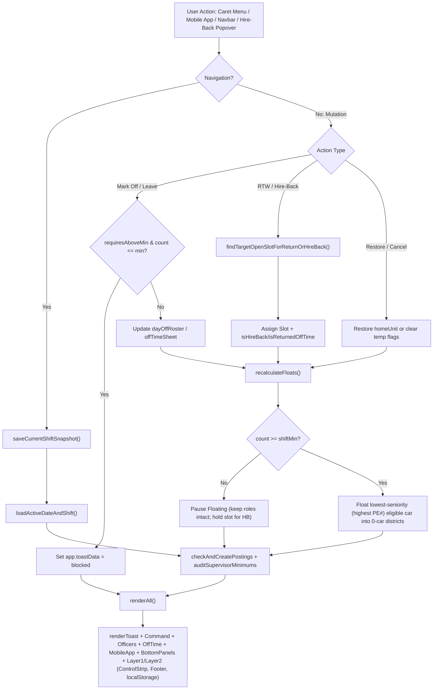

# ARCHITECTURE.md — FWPD "The Books"

**Repository:** `/home/antigravity/macc0311/fwpd-the-books`  
**Active Branch:** `macc-dev` (merged with `bmac-dev`, synced with `main`)  
**Primary Runtime Artifacts:** `index.html` (12,902 lines / 355,738 bytes) + modular extensions in `css/` (`hireback-engine.css`, `print-rollcall.css`) and `js/` (`hireback-engine.js`, `persistence-print-export.js`)  
**Target Environment:** Zero-build static browser SPA / GitHub Pages (`macc0311/fwpd-the-books`), backed by browser `localStorage` (`fwpd_the_books_state_v3_0_unified`) and JSON/CSV export

---

## 1. Repository Inventory & Branch Topology

### 1.1 Files on Disk

| File | Size (Bytes) | Lines | Role |
| :--- | ---: | ---: | :--- |
| `index.html` | 355,738 | 12,902 | Core application: CSS design system, DOM layout, multi-shift/bureau schedule templates (`ALL_SCHEDULES` + `DB_SCHEDULES`), 290-officer `MASTER_OPERATIONS_DIRECTORY`, core float/leave/RTW/search engines, companion mobile UI, standalone release exporter, and bottom `<link>`/`<script>` extension includes (`L12895-12899`). |
| `js/hireback-engine.js` | 111,464 | 2,444 | Zero-Touch Hire-Back & Overtime Bidding Engine (`PBA Art. 35` & `FOPLC Art. 24–26`): countdown auto-award (`12s` seniority / `<24h` FCFS), partial `4h` split blocks, `C`-shift AM training Last-4h rule, Duty Chief post-start gate, Supervisor/Acting COD audit, un-awarded HB cancellation alerts to opted-in officers, and lifecycle hooks wrapping `window.*` core handlers. |
| `js/persistence-print-export.js` | 32,164 | 788 | `localStorage` auto-save/restore (`fwpd_the_books_state_v3_0_unified`), 1-page US Letter Landscape Roll-Call Print Preview + standalone printable HTML download, `.json` state backup/restore, and roster/audit `.csv` exporters. |
| `css/hireback-engine.css` | 2,692 | 114 | Styling for `#hbZeroTouchControlBar`, notice mode pills, `.row-hireback-awarded`, `.row-acting-cod`, `.row-cmd-off`, timer progress bars, and print-mode suppression. |
| `css/print-rollcall.css` | 9,897 | 346 | Backup/Export dropdown styles, `@media print` & `body.rollcall-print-preview` single-page US Letter Landscape layout, `#rollCallPrintPreviewToolbar`, and `#printRollCallFooter`. |
| `docs/ARCHITECTURE.md` | — | — | Codebase topology, DOM/CSS map, state & schema specification, modular hook chain, subsystem inventory, and known technical debt. |
| `docs/RULES.md` | — | — | Enforced runtime business rules, consolidated 2026 PBA & FOPLC CBA reference, gap analysis, and engineering guardrails. |

> **Archived CBA Sources (Token Optimization):** Raw contract source files (`PBA_Contract_2026.md`, `PBA_Contract_2026.docx`, `FOPLC_Contract_2026.md`, `2026 FOPLC Final Contract.pdf` — preserved at commit `e91d318`) and `CONTRACT_RULES.md` (`10bdf32`) were consolidated into `docs/RULES.md` and removed from the active tree to keep repository scans fast and token-efficient.

### 1.2 Git Branch & Recent History

- **`macc-dev`** (`* macc-dev`, tracking `origin/macc-dev`): Active development branch containing both Luke's base platform and Ben's (`bmac-dev`) modular `js/` & `css/` extensions with integration fixes verified.
- **`main`** (`origin/main`, `origin/HEAD -> origin/main`): Production/GitHub Pages branch kept aligned cleanly with `macc-dev` (excluding `CONTRACT_RULES.md` and raw `.md`/`.docx`/`.pdf` contracts).
- **`bmac-dev`** (`origin/bmac-dev`): Collaborator development branch (`bf7d6f0`, merged into `macc-dev`) introducing `css/` and `js/` modular add-ons for zero-touch hire-back countdowns, supervisor/Acting COD auditing, `localStorage` persistence, and 1-page roll-call print/export.
- **Key Recent Commits:**
  - `bf7d6f0` (`bmac-dev`) — Added `12s` bid timer, FCFS `0`-bid waiting mode, and un-awarded Hire-Back cancellation notifications to all opted-in officers (merged & integration-fixed into `macc-dev`).
  - `a5bacbd` / `9cefa6f` — Option A cleanup consolidating `CONTRACT_RULES.md` into `docs/RULES.md` and `docs/ARCHITECTURE.md`.
  - `6123c40` — Pause floating when shift drops below minimum so awarded Hire-Back fills vacated role directly.
  - `b230954` — Automate Hire-Back opt-in notifications, bidding engine (`>=24hr` seniority vs `<24hr` FCFS), and winner schedule placement.
  - `66f685c` / `4dcbd71` — Searchable `MASTER_OPERATIONS_DIRECTORY` Hire-Back database with `A | B | C | All` filter tabs.

---

## 2. High-Level System Architecture & External Coupling

```
+-----------------------------------------------------------------------------------+
|                               index.html (12,902 lines)                           |
|                                                                                   |
|  1. <head> (L3-213)         : Tailwind CDNs + CSS Custom Properties & Grid CSS    |
|  2. <body> HTML (L214-647)  : Header Navbar, Toast, Split Workspace, Popover      |
|  3. Data Layer (L650-10244) : DIV_DISTRICTS, ALL_SCHEDULES + DB_SCHEDULES,        |
|                               MASTER_OPERATIONS_DIRECTORY, DEFAULT_OPT_IN_PES     |
|  4. State & Helpers (L10246): app state + savedHistory                            |
|  5. Core Engines (L10649+)  : Float Engine, Popovers, Hire-Back DB, Leave/RTW     |
|  6. Renderers (L11829+)     : Worksheet, Off-Time, Mobile App, Bottom Cards       |
|  7. Exporter (L12758-12891) : Standalone HTML builder & GitHub publish modal      |
|  8. Extensions (L12895-99)  : css/print-rollcall.css, css/hireback-engine.css,    |
|                               js/hireback-engine.js, js/persistence-print-export.js|
+-----------------------------------------+-----------------------------------------+
                                          | DOMContentLoaded hook chain
          +-------------------------------+-------------------------------+
          v                                                               v
+-----------------------------------+                       +-------------------------------+
|    js/hireback-engine.js (IIFE)   |  window.renderAll()   | js/persistence-print-export.js|
|  Layer 1 wrappers on core globals | <-------------------- |  Layer 2 wrappers + Navbar UI |
|  Timer loop, Supv/COD audit, HB   |                       |  Print preview & localStorage |
+-----------------------------------+                       +-------------------------------+
```

### 2.1 External Dependencies & Persistence Architecture

1. **Tailwind CSS Runtime Coupling (`index.html` L7–8):**
   - Loads **both** `https://www.gstatic.com/antigravity/web/dev/tailwindcss.min.js` (L7) and `https://cdn.tailwindcss.com` (L8) in `<head>`.
   - Zero build pipeline; Tailwind utility classes are compiled client-side in the browser at runtime.
2. **`localStorage` Auto-Persistence + In-Memory `savedHistory`:**
   - Every render (`window.renderAll`), theme toggle, view mode toggle, and JSON import persists full state (`schemaVersion: "3.0.0"`, `selectedBureau/Date/Shift`, `command`, `officers`, `dayOffRoster`, `offTimeSheet`, `hireBackOptInPes`, `hireBackNoticeMode`, `hireBackBids`, `floatedMoves`, `auditEntries`, `savedHistory`, and `hbEngine`) under `localStorage` key **`fwpd_the_books_state_v3_0_unified`**.
   - On startup, `persistence-print-export.js` restores `localStorage` automatically (`restoreStateFromStorage()`), then `hireback-engine.js` re-audits open shortages and resumes countdown timers.
   - Clicking `↺ Reset` (`resetSchedule()`) clears `localStorage` (`STORAGE_KEY`), resets `app.hbEngine`, restores factory defaults, and updates `#persistenceStatusBadge` to `↺ Reset to Default`.
   - Switching bureau/date/shift still checkpoints the active worksheet in `app.savedHistory` (`saveCurrentShiftSnapshot()`).
3. **Preview Artifact & Standalone Release Exporter (`L12752-12891`):**
   - `#publishHelperBtn` (`L321`) auto-hides on `github.io` (`L12753`).
   - `buildStandaloneReleaseHtml()` (`L12758-12783`) strips injected preview styles lacking `--bg-app` **and** strips runtime-injected modular DOM elements (`#publishHelperBtn`, `#publishHelperModal`, `#hbZeroTouchControlBar`, `#persistenceStatusBadge`, `#printRollCallBtn`, `#backupExportDropdownWrap`, `#printRollCallFooter`, `#rollCallPrintPreviewToolbar`, `#hbBidderNotificationModal`, `#mobileHbLiveCenter`) so exported HTML cleanly re-creates fresh DOM controls and event listeners on load.

---

## 3. CSS Design System & State Styling

### 3.1 Theme Custom Properties (`index.html` `:root` L10–29 & `body.dark-mode` L31–50)

| CSS Token | Light (`:root`) | Dark (`body.dark-mode`) | Purpose |
| :--- | :--- | :--- | :--- |
| `--bg-app` | `#f1f5f9` | `#090d16` | Page canvas background (also sentinel checked in `buildStandaloneReleaseHtml()` L12762) |
| `--bg-surface` | `#ffffff` | `#111827` | Cards, popovers, shift metrics boxes |
| `--bg-subtle` | `#f8fafc` | `#1e293b` | Unit cells, sheet header/footer bars, floated-out slots |
| `--bg-header` | `#0f172a` | `#0f172a` | Top navbar background token |
| `--bg-div-head` | `#1e293b` | `#1e293b` | 4-Division table title bar background |
| `--bg-col-head` | `#f1f5f9` | `#1f2937` | `UNIT / COMMAND / OFFICERS / ASSIGN` sub-header background |
| `--border-grid` | `#e2e8f0` | `#1f2937` | Inner table cell hairline borders |
| `--border-strong` | `#cbd5e1` | `#374151` | Card borders and `.div-sep-right` division separators |
| `--text-main` | `#0f172a` | `#f8fafc` | Primary body and officer name text |
| `--text-muted` | `#64748b` | `#94a3b8` | PE numbers, unit codes, subheaders, metadata |
| `--text-faint` | `#94a3b8` | `#475569` | Footer date watermark |
| `--accent-blue` | `#2563eb` | `#3b82f6` | Logged-in officer accent & hover caret highlight |
| `--accent-blue-soft` | `#eff6ff` | `rgba(59, 130, 246, 0.14)` | Logged-in row background tint |
| `--float-bg` | `#fffbeb` | `rgba(245, 158, 11, 0.14)` | Floated-in / Hire-Back / RTW destination highlight |
| `--float-border` | `#f59e0b` | `#f59e0b` | Left 3px indicator bar on floated/temporary rows |
| `--float-text` | `#92400e` | `#fde68a` | Float contrast text token |
| `--dayoff-bg` | `#fef2f2` | `rgba(239, 68, 68, 0.12)` | Dynamic marked-off cell tint in bottom Off-Time table |
| `--dayoff-text` | `#991b1b` | `#fca5a5` | Dynamic marked-off officer name text color |

### 3.2 Core & Modular Component Classes

| Selector | Source | Visual Behavior & Purpose |
| :--- | :--- | :--- |
| `.books-sheet-card`, `.books-table`, `.div-sep-right`, `.div-title-cell`, `.col-sub-cell`, `.unit-cell`, `.unit-bid-car` | `index.html` (`L60-129`) | Worksheet grid, division dividers, bid-car emerald highlight (`inset 2.5px 0 0 #10b981`). |
| `.row-logged-in`, `.row-floated-in`, `.row-floated-out`, `.caret-btn`, `#floatingActionMenu`, `.phone-frame` | `index.html` (`L132-211`) | Logged-in tint, float/RTW pulse highlight, caret menu trigger, popover, `340px` mobile bezel. |
| `.hb-control-strip`, `.hb-mode-pill`, `.hb-timer-bar-bg/fill` | `css/hireback-engine.css` (`L7-58, L88-100`) | Zero-Touch Hire-Back control strip, notice pills (`active-24plus`, `active-under24`, `active-started`), live timer bars. |
| `.row-hireback-awarded`, `.row-acting-cod`, `.row-cmd-off` | `css/hireback-engine.css` (`L61-85`) | Emerald Hire-Back award highlight + pulse, amber Acting COD highlight, marked-off command cell tint. |
| `.backup-dropdown-wrap/menu/item`, `.save-badge-flash` | `css/print-rollcall.css` (`L15-78`) | Backup/Export navbar dropdown menu and `✓ Saved` animation. |
| `.print-preview-toolbar`, `.print-only-footer`, `body.rollcall-print-preview`, `@media print` | `css/print-rollcall.css` (`L6-12, L84-345`) | Compact 1-page US Letter Landscape print/preview styling (`#printRollCallFooter` footer shown only in print/preview). |

---

## 4. Top-Level HTML Layout & Runtime-Injected DOM Regions

| Region | Source | Key DOM IDs & Controls |
| :--- | :--- | :--- |
| **1. Top Navbar (`<header>`)** | `index.html` (`L221-327`) + `persistence-print-export.js` (`L609-686`) | `#shiftHistoryStateBadge`, `#viewBtn-split/sheet`, `#bureauSeg-OPS/DB`, `#scheduleDateInput`, `#shiftSeg-A/B/C`, `#loggedInUserSelect`, `#floatScopeSelect`, `#themeToggleBtn`, injected `#persistenceStatusBadge`, `#printRollCallBtn`, `#backupExportDropdownWrap` (`#backupExportBtn`, `#backupExportMenu`, `#scheduleJsonFileInput`), `resetSchedule()`, `#publishHelperBtn`. |
| **2. Zero-Touch Hire-Back Strip** | `hireback-engine.js` (`L1501-1697`) | `#hbZeroTouchControlBar` injected directly above `#transactionToast`; renders notice mode pills (`12s` Seniority / `<24h` FCFS / Shift Started + Duty Chief toggle), `ACTING COD` / quadrant sergeant badges, active `HB-*` countdown cards (`#hbTopTimerText-*`, `#hbTopTimerBar-*`), and un-awarded cancellation banners. |
| **3. Transaction & Contract Toast** | `index.html` (`L332`) | `#transactionToast` — blocked-action alert (with `forceApprovePendingDayOff()`) or 3-step contract audit toast + live Broadcast/Winner bar. |
| **4. Split Workspace Grid** | `index.html` (`L337-638`) | Left `.books-sheet-card` (`#sheetMinBanner`, `#divTitle-*`, `#divCount-*`, `#paperCommandBody`, `#paperOfficersBody`, `#paperScheduledOffTimeBody`, `#offColCount-*`, injected `#printRollCallFooter`) + Right `#mobileAppPane` (`#mobileAppShiftBadge`, `#mobileAppBody`, injected `#mobileHbLiveCenter`). |
| **5. Bottom 3-Column Analytics & Audit** | `index.html` (`L555-591`) | `#floatQueueMiniList`, `#hireBackCountBadge`, `#districtCoverageMiniGrid`, `#hireBackActionBox` (enhanced by `renderEnhancedHireBackCard()`), `#auditMiniList`. |
| **6. Floating Popover & Modals** | `index.html` (`L645-647`) + JS modules | `#floatingActionMenu` / `#floatingMenuContent` (officer, static-off, day-off, command `openCommandActionPopover`, and Hire-Back DB `openHireBackPopover`), injected `#rollCallPrintPreviewToolbar`, dynamic `#publishHelperModal`. |

---

## 5. JavaScript Data Layer & Record Schemas (`index.html` L650–10244)

> **Important Architectural Note:** There are **no** constants named `BUREAU_SCHEDULE_KEYS`, `SCHEDULE_KEY_MAP`, `OFF_TIME_STATIC_SHEETS`, `HISTORICAL_SHIFTS`, or `HIREBACK_POOL` (`HIREBACK_POOL` was removed in commit `66f685c` and its dead `fillHireBackNow()` reference was removed during `bmac-dev` integration). Bureau/date/shift mapping is implemented procedurally in `resolveScheduleTemplate()`, static off-time data is embedded as `offTimeSheet` inside each schedule object, and historical/edited states are cached per-session in `app.savedHistory` and `localStorage`.

### 5.1 Core Constants

- `DIV_KEYS` (`L653`): `['NW', 'NE', 'SW', 'SE']`
- `DIV_DISTRICTS` (`L654-659`):
  - `NW`: `['A', 'B', 'C']`
  - `NE`: `['E', 'F', 'G']`
  - `SW`: `['I', 'J', 'K', 'L']`
  - `SE`: `['D', 'M', 'N', 'O']` *(includes Downtown `D` cars `D11–D92`)*
- `DEFAULT_HIREBACK_OPT_IN_PES` (`L10244`): `[1689, 1742, 1746, 1860, 1997, 2013, 1586, 1732, 1844, 1924, 2021]` (11 pre-opted-in PEs).

### 5.2 Schedule Templates (`ALL_SCHEDULES` L661–5397 + `DB_SCHEDULES` L5398–7625)

`DB_SCHEDULES` is merged into `ALL_SCHEDULES` at `L7626` via `Object.assign(ALL_SCHEDULES, DB_SCHEDULES)`.

| Key | Lines | Bureau | Shift / Hours | Initial Min | Initial Occupied | Bid Cars | Notes |
| :--- | :--- | :--- | :--- | ---: | ---: | ---: | :--- |
| `A_11_15` | `L662-1817` | `OPS` | `A` (`0600–1430 hrs`) | 32 | 32 (`8/8/9/7`) | 14 | Default boot schedule (`2026-11-15`); default PE `1883` (`MAURER, A`). |
| `A_11_17` | `L1818-3010` | `OPS` | `A` (`0600–1430 hrs`) | 32 | 36 (`8/8/9/11`) | 14 | Includes `specialAlert: "ONE LT. AND ONE OFF. HIRE BACK NEEDED"`. |
| `B_11_16` | `L3011-4204` | `OPS` | `B` (`1400–2230 hrs`) | 40 | 42 (`10/8/11/13`) | 13 | Default PE `2091`. |
| `C_11_15` | `L4205-5397` | `OPS` | `C` (`2200–0630 hrs`) | 34 | 36 (`9/7/10/10`) | 14 | Includes 3 occupied `K9` rows (`K9-3`, `K9-12`, `K9-8`) and `guardDutyNote`. |
| `DB_FLEX` | `L5399-6495` | `DB` | `A` (`0800–1630 hrs (Flex)`) | 30 | 48 (`6/12/12/18`) | 0 | Custom `colHeaders` (Property/Vice, Crimes Against Person, Auto/Fin/DV/Crime Scene, Juv/Homicide/Robbery), 12 cmd rows/col, 27 officer rows/col with 16 `sectionHeader` dividers. |
| `DB_C` | `L6496-7625` | `DB` | `C` (`1100–0730 / 1800–0200 hrs`) | 2 | 5 (`3/2/0/0`) | 0 | Custom `colHeaders`, 2 rendered cmd rows (of 12 stored), 27 officer rows/col with 4 `sectionHeader` dividers. |

#### Schedule Object Schema
```js
{
  id: string,                  // e.g. "A_11_15", "DB_FLEX"
  bureau?: "DB",               // present on DB_SCHEDULES templates
  shiftCode: "A" | "B" | "C",
  shiftTitle: string,
  shiftHours: string,
  dateStr: string,
  shortTab?: string,           // OPS only
  footerDate: string,
  shiftMin: number,
  defaultOfficerPe: number,
  codLabel: string,
  specialAlert: string,
  guardDutyNote: string,
  colHeaders?: string[4],      // DB only; overrides default 4-division headers
  command: { NW: CommandRow[], NE: CommandRow[], SW: CommandRow[], SE: CommandRow[] },
  officers: { NW: OfficerRow[], NE: OfficerRow[], SW: OfficerRow[], SE: OfficerRow[] },
  offTimeSheet: {
    dayOff: string[],
    vacation: string[],
    sickAndLeave: string[],
    trainingAndSpecial: string[]
  }
}
```

#### Command, Officer & Static Off-Time Schemas
- **Command Row (`command[div][i]`):** `{ unit: string, name: string, pe: number|null, assign: string, bold?: boolean, highlight?: boolean }`
- **Officer Row (`officers[div][i]`):** `{ unit: string, bidCar: boolean, name: string, pe: number|null, assign: string, partner?: string, highlight?: boolean, sectionHeader?: string }`
  - When `sectionHeader` is present (Detective Bureau), `renderPaperOfficerRows()` (`L12083-12086`) renders a `colspan="3"` section divider instead of a car row.
- **Static Off-Time String (`offTimeSheet[colKey][i]`):** Parsed by `parseStaticOffTimeString()` (`L10281-10302`) using regex `/^(.+?)\s*\((\d+)\)\s*(.*?)(?:\[(.+?)\])?\s*$/` into `{ name, pe, hrs, tag, rawStr, colKey, idx }`. Example: `"HAWTHORNE, C (1909) 8.5 hrs [PREF. VACATION]"`.

### 5.3 Master Operations Directory (`MASTER_OPERATIONS_DIRECTORY`, `L7628-10239`)

Array of **290 unique officer/command records** across shifts (`A`: 97, `B`: 103, `C`: 90) and roles (`OFFICER`: 127, `OFF_TIME`: 120, `PARTNER/PROB`: 15, `COMMAND`: 28):
```js
{
  name: string,     // e.g. "AGUILAR, M"
  pe: number,       // e.g. 1873 (unique across all 290 entries)
  role: "OFFICER" | "OFF_TIME" | "PARTNER/PROB" | "COMMAND",
  shift: "A" | "B" | "C",
  schedId: string,  // e.g. "A_11_17", "B_11_16", "C_11_15"
  unit: string,     // e.g. "F223" or "OFF"
  div: string       // "NW" | "NE" | "SW" | "SE" | ""
}
```

### 5.4 Leave Configuration Map (`LEAVE_CONFIG_MAP`, `L11349-11398`)

| Action Key | `shortCode` | `categoryCol` | `requiresAboveMin` | `article` |
| :--- | :--- | :--- | :---: | :--- |
| `DAY_OFF_VAC` | `VAC / DAY OFF` | `vacation` | `true` | `Art. 43 §4` |
| `DAY_OFF_PERS` | `PERSONAL` | `vacation` | `true` | `Art. 44 §1` |
| `DAY_OFF_FLSA` | `FLSA COMP` | `vacation` | `true` | `Art. 39 §2` |
| `SICK` | `SICK LEAVE` | `sickAndLeave` | `false` | `Art. 50 & Art. 35 §3` |
| `BEREAVEMENT` | `BEREAVEMENT` | `sickAndLeave` | `false` | `Art. 45` |
| `UTB` | `UNION TIME` | `trainingAndSpecial` | `false` | `Art. 16 §1` |

---

## 6. Application State & Snapshot Lifecycle (`index.html` L10246–10484)

### 6.1 Global State Objects

- **`app` (`L10246-10268`):**
  - `selectedBureau`: `'OPS'` \| `'DB'` (default `'OPS'`)
  - `selectedDate`: ISO `'YYYY-MM-DD'` string (default `'2026-11-15'`)
  - `selectedShift`: `'A'` \| `'B'` \| `'C'` (default `'A'`)
  - `activeScheduleId`: `'A_11_15'` (resolved template ID)
  - `shiftMin`: `32` (editable via `changeMinimum()`, `setMinForVacationDemo()`, or `forceApprovePendingDayOff()`)
  - `loggedInPe`: `1883` (numeric PE# or `'COD'`)
  - `viewMode`: `'split'` \| `'sheet'`
  - `darkMode`: `boolean`
  - `command`, `officers`, `offTimeSheet`: active mutable clones for the current shift view
  - `dayOffRoster`: `{ NW: [], NE: [], SW: [], SE: [] }` — dynamic marked-off officers (`{ homeUnit, div, name, pe, status, categoryCol, fullLabel, time }`)
  - `floatedMoves`: `Array<{ name, pe, fromUnit, fromDiv, toUnit, toDiv, district }>`
  - `auditEntries`: `Array<{ time, msg, tag }>` (newest prepended via `unshift`)
  - `toastData`: `null` \| `{ status: 'approved'|'blocked', title, step1, step2?, step3?, pendingAction? }`
  - `hireBackNoticeMode`: `'SENIORITY_24HR'` \| `'FCFS_UNDER_24HR'`
  - `hireBackOptInPes`: `number[]` (initialized from `DEFAULT_HIREBACK_OPT_IN_PES`)
  - `hireBackBids`: `Array<{ pe, name, shift, unit, timestamp, bidOrder }>`
  - `hireBackBidCounter`: monotonic integer tracking submission order
  - `hireBackLastWinnerNotification`: `null` \| `{ pe, name, shift, assignedUnit, assignedDiv, ruleLabel, timestamp }`
  - `savedHistory`: `Record<string, Snapshot>` keyed by `` `${selectedBureau}_${selectedDate}_${selectedShift}` ``
- **`app.hbEngine` (`js/hireback-engine.js` `L44-70`):** Modular state subtree persisted inside `localStorage` and `JSON` exports:
  - `noticeMode`: `'ADVANCE_24PLUS' | 'SHORT_UNDER24' | 'SHIFT_STARTED'`
  - `dutyChiefAuthorized`: `boolean` (`FOPLC Art. 24 §4D` gate for post-shift-start hire-backs)
  - `autoSimulateBids`, `timerPaused`: `boolean`
  - `nextBidId`: monotonic integer (starts `101`, generating `HB-101`, etc.)
  - `openPostings`: `Array<{ id, kind: 'OFFICER'|'SUPERVISOR', rankRequirement, preferredDiv, slotLabel, scopeLabel, blockType: 'FULL'|'FIRST_4H'|'LAST_4H', noticeMode, secondsRemaining, totalSeconds, status, bids, createdAt }>`
  - `closedNotifications`: `Array<{ id, postingId, status: 'AWARDED'|'CANCELED_UNAWRD', winner?, notifiedBidders?, canceledRecipients?, ruleSummary, timestamp }>`
  - `supervisorStandbyList`: sequential callback standby list (`FOPLC Art. 24 §4B`)
  - `commandOffRoster`: marked-off supervisors `{ pe, name, rank, origUnit, origDiv, status, fullLabel, shortCode, time }`
  - `actingCodInfo`: `null | { name, pe, unit, div }` (`FOPLC Art. 24 §2A & Art. 25` senior Sgt Acting COD)
- **`hireBackDbState` (`index.html` `L10952-10956`):** `{ shiftFilter: 'ALL', preferredDiv: null, preferredUnit: null }`
- **Runtime Enrichments on `app.officers[div][i]` (`loadActiveDateAndShift` `L10436-10446` & mutations):**
  - `district` (`parseDistrict(row.unit)`), `homeName`, `homePe`, `homePartner`, `isHireBack`, `isReturnedOffTime`, `returnedMeta`, `hireBackShift`, `floatedFrom` (`{ unit, div }` \| `null`), `floatedTo` (`{ unit, div, name, pe }` \| `null`).

### 6.2 Snapshot Persistence (`saveCurrentShiftSnapshot` & `loadActiveDateAndShift`)

- Before any bureau, date, or shift change (`stepDate`, `handleDateInputChange`, `selectBureau`, `selectShiftCode`, `switchSchedule`), `saveCurrentShiftSnapshot()` (`L10345-10360`) deep-clones the current state (`shiftMin`, `command`, `officers`, `offTimeSheet`, `dayOffRoster`, `floatedMoves`, `hireBackBids`, `hireBackBidCounter`, `hireBackLastWinnerNotification`, `auditEntries`) into `app.savedHistory[key]`.
- `renderAll()` (`L11941-11946`) writes `app.savedHistory[key]` on every render pass, while `persistence-print-export.js` Layer 2 wraps `renderAll()` to update `#printRollCallFooter` and persist complete state (including `hbEngine`) to `localStorage`.
- `loadActiveDateAndShift(targetOfficerPe)` (`L10411-10478`) restores from `app.savedHistory[key]` if present, or instantiates a fresh clone from `resolveScheduleTemplate(selectedDate, selectedShift)`. Dates `< '2026-11-15'` are tagged `Historical Reflection` (`ARCHIVE`).

---

## 7. JavaScript Engines & Control Flow

### 7.1 Control Flow Overview



### 7.2 Core Engine Inventory (`index.html` `L10270-12893`)

1. **Bureau / Date / Shift Navigation & Utilities (`L10270-10597`):**
   - `clone(o)` (`L10270-10272`), `parseDistrict(unitStr)` (`L10274-10279`, excludes `K9*`), `parseStaticOffTimeString()` (`L10281-10302`), `formatLongDate()` (`L10304-10313`), `formatShortDate()` (`L10315-10323`).
   - `resolveScheduleTemplate(isoDate, shiftCode)` (`L10325-10343`) — resolves `DB_C` / `DB_FLEX` for `'DB'`, or `OPS` `2026-11-15`/`16`/`17` with odd/even `A`-shift fallback.
   - `saveCurrentShiftSnapshot()`, `stepDate()`, `handleDateInputChange()`, `selectBureau()`, `selectShiftCode()`, `switchSchedule()`, `loadActiveDateAndShift()`, `initApp()` (`L10345-10484`).
   - `populateUserSelect()`, `handleUserSwitch()`, `setViewMode()`, `toggleTheme()` (`L10486-10597`).

2. **Staffing Count, District Coverage & Lookup (`L10599-10647`):**
   - `findOfficerByPe(peNum)` (`L10599-10624`) — checks `'ON_DUTY'` → `'DAY_OFF'` → `'STATIC_OFF'` → `'OTHER_SHIFT'`.
   - `getShiftCount()` (`L10626-10634`), `getDistrictCounts()` (`L10636-10647`).

3. **Core Float Engine (`recalculateFloats`, `L10655-10749`):**
   - Phase 1 (`L10656-10675`): Deterministic reset preserving `isHireBack` and `isReturnedOffTime` rows.
   - Phase 2 Guard (`L10679`): **Below-minimum pause guard** (`if (currentCount >= app.shiftMin)`).
   - Phase 3 Iterative District Fill (`L10680-10745`): Fills `0`-car districts preferring vacated day-off unit → open non-bid car → open car, floating eligible donors (`bidCar !== true`, `distCounts[r.district] > 1`) in `quadrant` or `citywide` scope by highest `PE#` first; calls `populateUserSelect()` and `renderAll()`.

4. **Leave, Return-to-Work & Off-Time Management (`L10754-10947`, `L11336-11824`):**
   - Popover UI: `positionPopoverNearEvent()`, `openOfficerActionPopover()`, `closeActionPopover()`, `triggerLeaveAction()`.
   - Leave & Restore: `handleOfficerStatusSelect()`, `forceApprovePendingDayOff()`, `executeApprovedLeaveMove()`, `restoreOfficerFromDayOff()`, `handleDayOffActionSelect()`, `returnStaticOfficerToWork()`, `moveStaticOffTimeOfficer()`, `cancelTemporaryDutyRow()`.
   - Controls (`L11803-11824`): `changeMinimum(delta)` (`L11803-11806`) & `setMinForVacationDemo()` (`L11808-11818`) both invoke `recalculateFloats()`; `resetSchedule()` (`L11820-11824`).

5. **Automated Hire-Back Registry, Search DB & Bidding (`L10952-11605`):**
   - Opt-In & Ranking: `isOfficerOptedInForHireBack()`, `toggleOfficerHireBackOptIn()`, `setHireBackNoticeMode()`, `ensureAutomatedHireBackBroadcast()`, `getSortedHireBackBids()`, `submitOfficerHireBackBid()`, `autoAwardWinningHireBackBid()`.
   - Searchable Popover (`L11105-11334`): `openHireBackPopover()`, `renderHireBackPopoverSections()`, `setHireBackShiftFilter()`, `renderHireBackDatabaseResults()` (`A | B | C | ALL`, excludes `COMMAND` and on-duty PEs, sorted by `pe` asc).
   - Slot Resolution & Award: `findTargetOpenSlotForReturnOrHireBack()` (`L11400-11446`), `awardCrossShiftHireBack()` (`L11538-11605`).

6. **Rendering Pipeline (`L11829-12750`):**
   - `renderAll()` (`L11829-11949`) updates banners/counts/headers, saves snapshot, and invokes:
     - `renderToast()` (`L11951-12028`)
     - `renderPaperCommandRows()` (`L12033-12063`)
     - `renderPaperOfficerRows()` (`L12068-12163`)
     - `renderPaperScheduledOffTimeRows()` (`L12230-12291`) via `inferOffTimeCategory()` (`L12168-12175`), `formatStaticOffTimeEntry()` (`L12177-12210`), `formatDynamicMarkedOffEntry()` (`L12212-12228`)
     - `renderMobileAppCompanion(count, min)` (`L12296-12632` — mobile quick-switch buttons invoke `handleUserSwitch('1883'|'1586'|'1997')` at `L12325-12333`)
     - `renderBottomPanels(count, min)` (`L12637-12750`)

7. **Standalone Export / Publish Helper (`L12752-12891`):**
   - `buildStandaloneReleaseHtml()` (`L12758-12782`), `copyReleaseHtmlToClipboard()` (`L12784-12815`), `fallbackCopy()` (`L12817-12829`), `downloadReleaseHtmlFile()` (`L12831-12842`), `openPublishModalAndCopy()` (`L12844-12891`).

### 7.3 Zero-Touch Hire-Back Engine (`js/hireback-engine.js`, `2,444` lines — Layer 1)

Wrapped in an IIFE exposing UI controls onto `window` and attaching Layer 1 wrappers inside `hookHireBackEngine()` (`L2133-2444`):
- **Sections `1–3` (`L16-119`):** `EXTENDED_CANDIDATE_POOL` (off-duty Ops Patrol, DB Detectives, Exempt/Narcotics, LTs/Sgts), `BID_WINDOW_SECONDS = 12`, `FCFS_AUTO_FILL_SECONDS = 4`, `ensureEngineState()` (exposes `window.app = app`), `getNoticeModeDetails()`.
- **Sections `4–5` (`L120-359`):** `evaluateBidderEligibility()` (`L158-214`, blocks `dayOffRoster` / `commandOffRoster` self-mark-offs per `PBA Art. 35 §4` and sick/light-duty members per `FOPLC Art. 26`), `sortBidsForPosting()` (`L216-246`, Uniform division priority in `≥24h`), and `auditSupervisorMinimums()` (`L251-357`, `FOPLC Art. 24 §2` / `Art. 25` auto-elevation of senior Sgt to `ACTING COD` and `SUPERVISOR` Hire-Back triggering).
- **Sections `6–9` (`L360-1102`):** `createHireBackPosting()`, `syncAppHireBackBidsIntoPosting()`, `scheduleSimulatedBidsForPosting()`, `submitBidToPosting()`, `finalizeHireBackAward()`, `splitUnfilledPostingIntoPartialBlocks()`, `cancelUnAwardedPostings()` + `buildOptedInCancellationRecipients()` (`L844-980`, notifies all `app.hireBackOptInPes` & bidders when shortages resolve before award), `checkAndCreatePostingsForCurrentShortages()`, and 1-second `ensureTimerRunning()` timer tick loop.
- **Sections `10–13` (`L1104-2051`):** `openCommandActionPopover()`, `triggerCommandLeaveAction()`, `restoreSupervisorToDuty()`, `triggerCShiftTrainingLeave()` (`L1266-1302`), `setHbNoticeMode()`, `toggleDutyChiefAuth()`, `expirePostingNow()`, `simulateFirstBidderClaimNow()`, `returnOfficerToCancelHireBack()`, `splitPostingToPartialsNow()`, `userBidOrClaimPosting()`, plus UI renderers (`#hbZeroTouchControlBar`, `.row-acting-cod` / `.row-cmd-off`, enhanced `#hireBackActionBox`, `#mobileHbLiveCenter`).
- **Section `14` Hook Chain (`L2053-2444`):** Wraps `executeApprovedLeaveMove`, `restoreOfficerFromDayOff`, `returnStaticOfficerToWork`, `cancelTemporaryDutyRow` (plus fallback `removeHireBackOfficer`), `awardCrossShiftHireBack` (`closeMatchedOfficerPostingFromManualAward` closes open `OFFICER` postings on manual award and preserves award toast), `ensureAutomatedHireBackBroadcast` (`0`-bid suppression in `SHORT_UNDER24`/`SHIFT_STARTED`), `submitOfficerHireBackBid` (pre-checks `evaluateBidderEligibility` before instant FCFS claim), `setHireBackNoticeMode`, `changeMinimum`, `setMinForVacationDemo`, `openOfficerActionPopover` (`C`-shift training option), `loadActiveDateAndShift`, and `renderAll`.

### 7.4 Persistence, Print & Export Engine (`js/persistence-print-export.js`, `788` lines — Layer 2)

Wrapped in an IIFE loading after `js/hireback-engine.js`, attaching Layer 2 wrappers inside `hookGlobalFunctions()` (`L689-768`):
- **Section `1` (`L13-205`):** `serializeState()`, `saveStateToStorage()`, `applyStatePayload()`, `restoreStateFromStorage()` under `STORAGE_KEY = 'fwpd_the_books_state_v3_0_unified'`, plus `#persistenceStatusBadge`.
- **Section `2` (`L207-418`):** `triggerRollCallPrint()`, `updatePrintFooter()` (live A–O counts, float moves, legend, COD signature), `exitRollCallPrintPreview()`, and `downloadPrintableRollCallHtml()` (dynamic bureau/shift/date title & filename).
- **Section `3` (`L420-594`):** `exportScheduleJson()`, `handleImportJsonFile()`, `exportRosterCsv()`, and `exportAuditCsv()` with dynamic active bureau/shift/date filenames.
- **Section `4` (`L596-787`):** `injectNavbarControls()` (adds `#persistenceStatusBadge`, `#printRollCallBtn`, `#backupExportDropdownWrap`) and `hookGlobalFunctions()` (outer wrappers on `renderAll`, `toggleTheme`, `setViewMode`, `restoreOfficerFromDayOff`, `resetSchedule`, and `buildStandaloneReleaseHtml`).

---

## 8. Technical Debt, Known Defects & Fragility Warnings

Downstream engineering agents modifying `index.html`, `js/`, or `css/` must account for the following verified constraints and remaining items:

1. **Dual Tailwind Script Tags in `<head>` (`index.html` `L7-8`):**
   - Both `<script src="https://www.gstatic.com/antigravity/web/dev/tailwindcss.min.js"></script>` (L7) and `<script src="https://cdn.tailwindcss.com"></script>` (L8) are loaded. Removing either without testing across both Antigravity preview and GitHub Pages could alter utility class rendering.
2. **K-9 District Exclusion Side Effect (`index.html` `L10277`, `L10626-10634`, `L10698`, `L12645`):**
   - `parseDistrict('K9-3')` returns `''` (`L10277`). Because `distCounts['']` is `undefined`, the sole-district check `distCounts[r.district] <= 1` evaluates `undefined <= 1` → `false` in JavaScript. As a result, in `C_11_15` (where 3 K-9 rows are occupied), K-9 officers are counted by `getShiftCount()` and are not excluded from float candidate lists (`recalculateFloats` and `renderBottomPanels`), contrary to PBA Art. 23 §8.
3. **Hardcoded Row Loop Count (`31`) and Footer Date (`11/14/2026`) (`index.html` `L12072`, `L12136`):**
   - `renderPaperOfficerRows()` loops `for (let i = 0; i < 31; i++)` even on `DB_FLEX` and `DB_C` (which have 27 officer rows per column, rendering 4 blank trailing rows), and prints literal `11/14/2026` at `i === 30 && div === 'NW'` instead of reading `sched.footerDate`.
4. **Direct `ALL_SCHEDULES[app.activeScheduleId]` Lookup in Mobile Renderer (`index.html` `L12460`):**
   - `renderMobileAppCompanion()` accesses `ALL_SCHEDULES[app.activeScheduleId].shiftCode` and `.shiftHours` directly (relying on `Object.assign(ALL_SCHEDULES, DB_SCHEDULES)` at `L7626`), whereas `renderAll()` uses `resolveScheduleTemplate()`.
5. **`resetSchedule()` Hardcodes `app.shiftMin = 32` Before `initApp()` (`index.html` `L11820-11824`):**
   - `resetSchedule()` sets `app.shiftMin = 32` before calling `initApp()`, which then overwrites `app.shiftMin = tmpl.shiftMin`. Also `initApp()` only deletes the *currently selected* key from `app.savedHistory`, preserving other cached shifts/dates in memory while `persistence-print-export.js` clears `localStorage`.
6. **`setViewMode()` Button Class Drift (`index.html` `L10577-10591` vs `L242-247`):**
   - Initial HTML uses `px-2.5 py-1 rounded-md`, whereas `setViewMode()` overwrites `className` with `px-3 py-1.5 rounded-lg`.
7. **Global Hook & Wrapper Load-Order Coupling (`index.html` `L12758-12899`):**
   - All inline `<script>` helpers execute first (`initApp()`), then `js/hireback-engine.js` (Layer 1) wraps `window.*` functions and exposes lexical `let app` via `window.app`, and finally `js/persistence-print-export.js` (Layer 2) wraps outer `renderAll`, `restoreOfficerFromDayOff`, `resetSchedule`, and `buildStandaloneReleaseHtml`. Changing `<script>` order at `L12898-12899` or renaming wrapped global functions silently breaks auto-save, print footer updates, or shortage synchronization.
   - `buildStandaloneReleaseHtml()` (`L12758-12782`) depends explicitly on `--bg-app` inside `<head> <style>` and the exact IDs of runtime-injected DOM nodes (`#publishHelperBtn`, `#publishHelperModal`, `#hbZeroTouchControlBar`, `#persistenceStatusBadge`, `#printRollCallBtn`, `#backupExportDropdownWrap`, `#printRollCallFooter`, `#rollCallPrintPreviewToolbar`, `#hbBidderNotificationModal`, `#mobileHbLiveCenter`) so standalone HTML downloads re-initialize cleanly.
